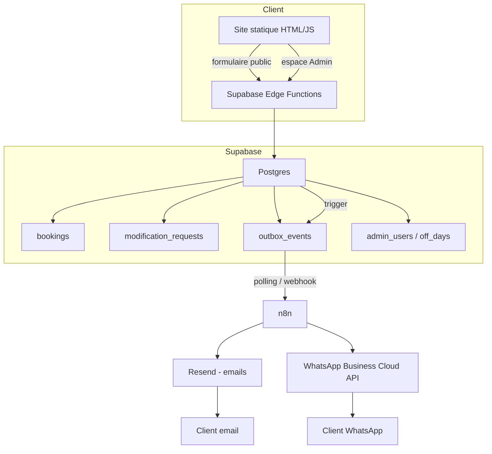
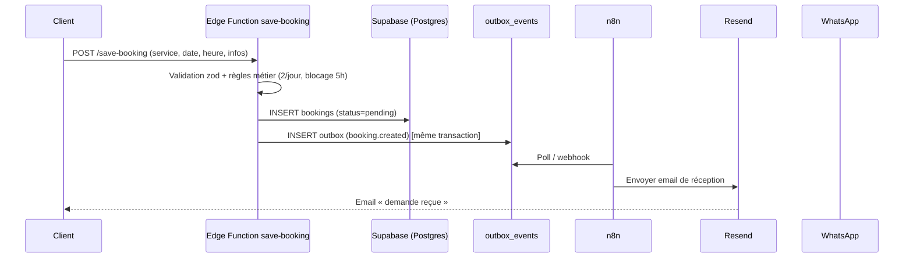
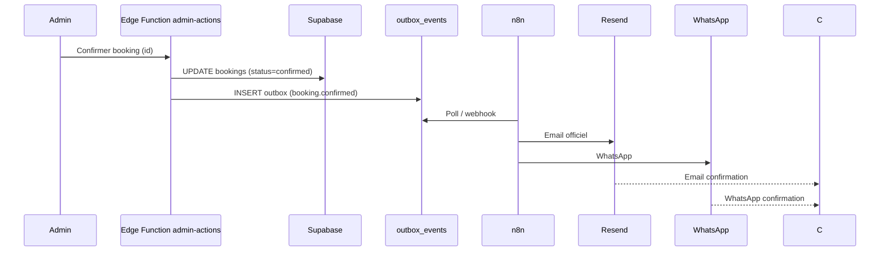

# ARCHITECTURE DU SYSTÈME DE RÉSERVATION — ANGEMUU

**Version :** 1.0 (conception — en attente de validation)
**Base :** audit [`plans/audit-technique-angemuu.md`](audit-technique-angemuu.md) + plan d'action [`plans/plan-action-opensource.md`](plan-action-opensource.md)
**Principe :** améliorer le système existant, **ne pas reconstruire le site**.

---

## 1. Technologies et compatibilité avec le projet existant

| Technologie | Rôle | Compatibilité avec le projet |
|---|---|---|
| **Supabase** (déjà en place) | Base de données, Auth, RLS, Edge Functions | ✅ Déjà utilisé. Le site appelle Supabase via `@supabase/supabase-js@2`. |
| **n8n** | Orchestration des automatisations (emails, WhatsApp) | ✅ Indépendant du frontend. Reçoit des événements via webhook/outbox. |
| **Resend** | Emails transactionnels | ✅ API HTTP simple, appelée par n8n. |
| **WhatsApp Business Cloud API** | Notifications WhatsApp | ✅ API HTTP officielle, appelée par n8n. |
| **shadcn/ui** | Composants d'interface | ⚠️ **React + Tailwind + bundler.** Le site est **HTML/JS vanilla sans build**. |
| **React DayPicker** | Calendrier | ⚠️ **React.** Le site est vanilla. |

### Décision UI (justifiée)

Le site Angemuu est **statique, sans build**, déployé tel quel sur Azure Static Web Apps. **shadcn/ui et React DayPicker exigent React + un bundler**, ce qui imposerait une refonte du frontend — contraire au principe « ne pas reconstruire ».

**Recommandation :** conserver le **calendrier vanilla façon shadcn** déjà implémenté ([`booking-calendar.js`](../assets/js/booking-calendar.js), [`booking-calendar.css`](../assets/css/booking-calendar.css)). Il reproduit l'esthétique shadcn sans introduire React.

> **Option hybride (si l'UI React devient indispensable)** : monter un **composant React isolé** (React UMD via CDN + un petit bundle) dans une `
` du site statique, uniquement pour le calendrier. Plus complexe et fragile — à éviter tant que le vanilla suffit.

**Conclusion :** les technologies serveur (Supabase, n8n, Resend, WhatsApp) sont **100 % compatibles** et n'exigent aucun changement du frontend. Seule l'UI reste en vanilla façon shadcn.

---

## 2. Architecture globale

### Flux de données (réservation)

### Flux de données (confirmation)

---

## 3. Schéma fonctionnel (base de données)

### 3.1 Table `bookings` (existante, enrichie)

| Colonne | Type | Rôle |
|---|---|---|
| `id` | uuid PK | Identifiant |
| `client_name`, `phone`, `email` | text | Coordonnées client |
| `date`, `time` | date, time | Créneau |
| `service`, `location`, `comment` | text | Détails |
| `status` | text | `pending` / `confirmed` / `rejected` / `canceled` |
| `created_at` | timestamptz | Horodatage |

> Contrainte UNIQUE partielle `(date, time)` sur `pending`/`confirmed` (déjà en place) + CHECK horaires.

### 3.2 Table `modification_requests` (nouvelle)

| Colonne | Type | Rôle |
|---|---|---|
| `id` | uuid PK | Identifiant |
| `booking_id` | uuid FK → bookings | Réservation concernée |
| `new_date` | date | Nouvelle date souhaitée |
| `new_time` | time | Nouvelle heure souhaitée |
| `justification` | text | Justification |
| `status` | text | `pending` / `accepted` / `rejected` |
| `created_at`, `resolved_at` | timestamptz | Horodatages |

### 3.3 Table `outbox_events` (nouvelle — outbox transactionnelle)

| Colonne | Type | Rôle |
|---|---|---|
| `id` | uuid PK | Identifiant (idempotence) |
| `event_type` | text | `booking.created`, `booking.confirmed`, … |
| `payload` | jsonb | Données de l'événement |
| `status` | text | `pending` / `sent` / `failed` |
| `attempts` | int | Nombre de tentatives |
| `created_at`, `sent_at` | timestamptz | Horodatages |

---

## 4. Événements transmis à n8n

| Événement | Déclencheur | Action n8n |
|---|---|---|
| `booking.created` | Insertion réservation (pending) | Email de réception au client |
| `booking.confirmed` | Admin confirme | Email officiel + WhatsApp |
| `booking.rejected` | Admin refuse | Email de refus |
| `booking.canceled` | Admin annule | Email d'annulation |
| `modification.requested` | Client demande une modification | Email/notification à l'admin |
| `modification.accepted` | Admin accepte | Email + WhatsApp au client |
| `modification.rejected` | Admin refuse | Email au client |

### Mécanisme fiable : outbox transactionnelle

- Chaque événement est inséré dans `outbox_events` **dans la même transaction** que la modification de la réservation (via la Edge Function ou un trigger DB).
- **n8n** (ou une Edge Function de relais) **poll** l'outbox toutes les X secondes, transmet les événements `pending` à n8n, puis marque `sent`.
- En cas d'échec, `attempts` s'incrémente et l'événement est retenté (backoff).
- **Avantage** : aucune perte d'événement si n8n est temporairement indisponible (fiabilité garantie).

> **Alternative plus simple** : webhook direct depuis la Edge Function vers n8n. Moins fiable (perte si n8n down). L'outbox est recommandée pour la robustesse.

---

## 5. Demande de modification (sans compte)

### Parcours
1. Le client ouvre le formulaire de modification (lien depuis l'email de confirmation, avec `booking_id` + token).
2. Il saisit : **nouvelle date**, **nouvelle heure**, **justification**.
3. La Edge Function `request-modification` valide et insère `modification_requests` (status `pending`).
4. L'ancienne réservation **reste confirmée** tant que la demande n'est pas acceptée.
5. L'admin voit la demande dans son espace Admin.

### Acceptation
- La Edge Function `admin-actions` vérifie la **disponibilité** du nouveau créneau (règles 2/jour + blocage 5h + contrainte UNIQUE).
- Si disponible : met à jour `bookings` (date/time), libère l'ancien créneau (automatique car le créneau change), insère `modification.accepted`.
- Si indisponible : refuse la modification et demande une nouvelle proposition (`modification.rejected`).

### Sécurité du formulaire
- **Token de modification** : un jeton signé (HMAC) émis à la création de la réservation, inclus dans l'email. Le formulaire exige ce token pour lier la demande à la bonne réservation.
- **Rate limiting** : limite de soumissions par IP/token.
- **Validation serveur** : zod (date future, heure dans les horaires, justification non vide).

---

## 6. Sécurité

### 6.1 Opérations côté serveur (Edge Functions)
Toutes les opérations critiques passent par des **Edge Functions** (jamais par le client direct) :
- `save-booking` : validation + insertion + outbox.
- `request-modification` : validation + insertion + outbox.
- `admin-actions` : confirmer/refuser/annuler, accepter/refuser modification + outbox.

### 6.2 Responsabilités des Edge Functions
- **Validation** des entrées (zod) et des règles métier.
- **Insertion atomique** (réservation + outbox dans la même transaction).
- **Contrôle d'accès** : les fonctions admin vérifient `is_admin()` via le JWT.
- **Jamais de secrets exposés** : les clés (service_role, Resend, WhatsApp) restent dans les secrets des fonctions.

### 6.3 Règles RLS
| Table | RLS |
|---|---|
| `bookings` | INSERT public (via fonction) ; SELECT/UPDATE/DELETE admin only (`is_admin()`) |
| `modification_requests` | INSERT public (via fonction) ; SELECT/UPDATE admin only |
| `outbox_events` | **Aucun accès public** (uniquement service_role / fonction interne) |
| `admin_users` | Aucun accès public |
| `off_days` | SELECT public ; écriture admin |

### 6.4 Protection des accès administrateurs
- Supabase Auth (email/mot de passe) + `is_admin()` (vérifie le JWT côté serveur).
- `ADMIN_EMAILS` retiré du bundle public (déjà fait).
- Les fonctions admin vérifient la session à chaque appel.

### 6.5 Protection des formulaires de modification
- Token HMAC signé + rate limiting + validation serveur (voir §5).

### 6.6 Gestion des secrets
- **Supabase** : secrets des Edge Functions (service_role, clés).
- **n8n** : credentials chiffrés (Resend API key, WhatsApp token, webhook).
- **Jamais de secrets dans le code client** (le site public ne contient que la clé publishable).

### 6.7 Vérification des webhooks
- **n8n → Resend/WhatsApp** : appels sortants, pas de webhook entrant critique.
- **Resend/WhatsApp → n8n** (si webhooks de statut) : vérifier les signatures (X-Webhook-Signature / X-Hub-Signature-256).
- **Supabase → n8n** : l'outbox est pollée ; le webhook (si utilisé) doit être protégé par un secret partagé.

### 6.8 Idempotence des notifications
- Chaque événement a un `id` unique (`outbox_events.id`).
- n8n **déduplique** par `event_id` (stocke les ids traités).
- Les appels Resend/WhatsApp utilisent un **idempotency key** (ex. `event_id`).

---

## 7. Responsabilités de chaque service

| Service | Responsabilités |
|---|---|
| **Site statique** | Formulaire public, espace Admin, calendrier vanilla façon shadcn. Aucune logique métier critique. |
| **Supabase (Postgres)** | Stockage, RLS, contraintes, outbox transactionnelle. |
| **Supabase Edge Functions** | Validation, règles métier, insertion atomique, contrôle d'accès admin. |
| **n8n** | Orchestration : envoi d'emails (Resend) et WhatsApp selon les événements. |
| **Resend** | Emails transactionnels (réception, confirmation, refus, modification). |
| **WhatsApp Business Cloud API** | Notifications WhatsApp (confirmation, modification acceptée). |

---

## 8. Dépendances techniques

| Dépendance | Usage | Source |
|---|---|---|
| `@supabase/supabase-js@2` | Client (déjà en place) | CDN |
| Supabase Edge Functions (Deno) | Fonctions serveur | Supabase |
| n8n | Orchestration | [n8n-io/n8n](https://github.com/n8n-io/n8n) |
| Resend SDK / API | Emails | [resend.com/docs](https://resend.com/docs) |
| WhatsApp Cloud API | Notifications | [developers.facebook.com](https://developers.facebook.com/docs/whatsapp/cloud-api/) |
| zod | Validation serveur | esm.sh |
| Calendrier vanilla façon shadcn | UI (déjà implémenté) | — |

---

## 9. Coûts et limites

| Service | Plan | Coût | Limites |
|---|---|---|---|
| **Supabase** | Free | 0 € | 500 Mo DB, 500 K invocations Edge Functions/mois, 50 K MAU |
| **n8n Cloud** | Starter | ~20–24 €/mois | 2,5 K exécutions/mois (selon plan) |
| **n8n Community** | Auto-hébergé | 0 € (logiciel) + hébergement | Maintenance + VPS (~5–10 €/mois) |
| **Resend** | Free | 0 € | 3 000 emails/mois (100/jour) |
| **WhatsApp Cloud API** | Gratuit (messages de service) | 0 € (début) | Coût par conversation au-delà de la fenêtre 24 h ; templates approuvés requis |

**Estimation pour un salon de coiffure** (faible volume) : **0 €/mois** en Supabase Free + Resend Free + n8n Community auto-hébergé, ou **~20 €/mois** avec n8n Cloud.

---

## 10. Choix : n8n Cloud vs n8n Community auto-hébergé

| Critère | n8n Cloud | n8n Community (auto-hébergé) |
|---|---|---|
| Coût | ~20–24 €/mois | 0 € (logiciel) + VPS (~5–10 €/mois) |
| Maintenance | Aucune (géré) | Mises à jour, sauvegardes, supervision |
| Fiabilité | SLA, haute disponibilité | Dépend de l'hébergement |
| Contrôle | Limité | Total (données, versions) |
| Volume | Limité par plan | Illimité (selon ressources) |
| **Recommandation** | **Pour démarrer vite** | **Pour un contrôle total et coût minimal** |

**Recommandation :** pour un salon à faible volume, **n8n Community auto-hébergé** sur un petit VPS est le plus économique et suffisant. **n8n Cloud** est préférable si l'on veut zéro maintenance et une mise en place rapide.

---

## 11. Plan de développement (étape par étape)

### Phase A — Fondations (Supabase)
1. **Migrations** : tables `modification_requests`, `outbox_events` + index.
2. **Edge Function `save-booking`** : enrichir pour insérer l'événement `booking.created` dans l'outbox (même transaction).
3. **Edge Function `request-modification`** : formulaire de modification + token HMAC + outbox `modification.requested`.
4. **Edge Function `admin-actions`** : confirmer/refuser/annuler + accepter/refuser modification + outbox.

### Phase B — Outbox & relais
5. **Trigger DB** (ou fonction) : insertion automatique dans l'outbox.
6. **Relais outbox → n8n** : polling (Edge Function ou script) qui transmet les événements `pending` et marque `sent`.

### Phase C — n8n
7. **Installer n8n** (Cloud ou Community).
8. **Credentials** : Resend API key, WhatsApp token, webhook secret.
9. **Workflows** : `booking.created`, `booking.confirmed`, `booking.rejected`, `booking.canceled`, `modification.requested`, `modification.accepted`, `modification.rejected`.
10. **Idempotence** : déduplication par `event_id`.

### Phase D — Emails & WhatsApp
11. **Resend** : templates (réception, confirmation, refus, annulation, modification).
12. **WhatsApp** : numéro + templates approuvés (confirmation, modification acceptée).

### Phase E — UI
13. **Formulaire de modification** (page statique) : nouvelle date/heure + justification + token.
14. **Espace Admin** : affichage des demandes de modification + boutons accepter/refuser.

### Phase F — Tests & déploiement
15. Tests du parcours complet (réservation → email → confirmation → WhatsApp → modification).
16. Déploiement des Edge Functions + migrations + n8n workflows.

---

## 12. Points à valider

1. **UI** : confirmez-vous de garder le **calendrier vanilla façon shadcn** (recommandé) plutôt que d'introduire React ?
2. **n8n** : Cloud ou Community auto-hébergé ?
3. **Outbox** : polling (recommandé) ou webhook direct ?
4. **WhatsApp** : avez-vous un numéro WhatsApp Business + accès à la Cloud API ?
5. **Resend** : avez-vous un domaine vérifié pour l'envoi d'emails ?
6. **Modification** : le token HMAC (lien dans l'email) est-il acceptable pour lier la demande à la réservation ?