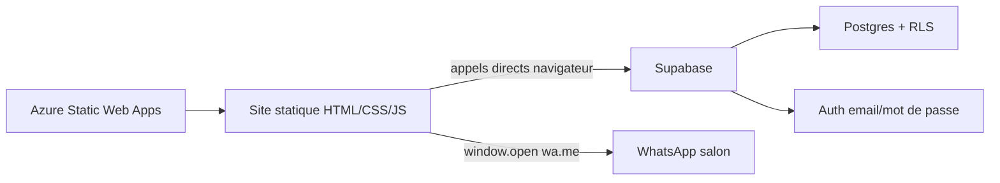
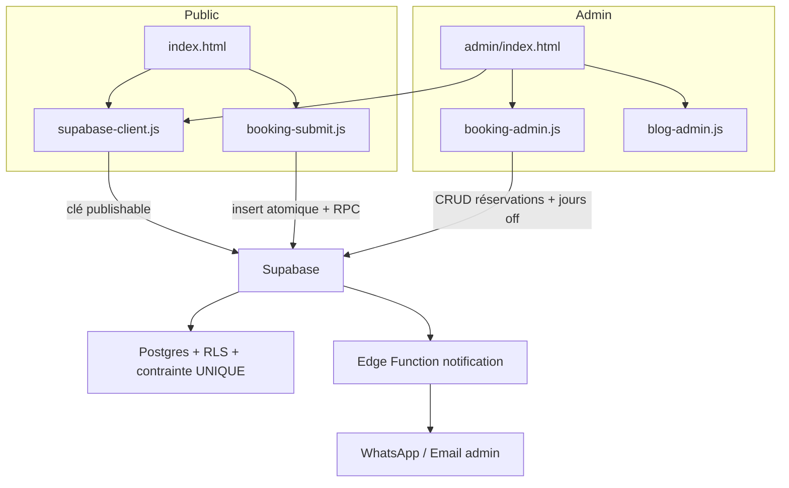

# AUDIT TECHNIQUE — PROJET ANGEMUU

**Date :** 2026-11-03
**Site :** https://angemuu.net/
**Repo :** HERVE-KOUAM/Angemuu
**Périmètre :** Système de réservation (phase 1 — audit uniquement, aucune modification)

---

## 1. Architecture actuelle du projet

### 1.1 Vue d'ensemble

Le projet est un **site statique** (HTML/CSS/JS vanilla) hébergé sur **Azure Static Web Apps**, adossé à un backend **Supabase** (PostgreSQL + Auth + Row Level Security). Il n'y a **aucune étape de build** (`package.json` → `"build": "echo 'No build required'"`).



**Point critique :** le système de réservation fonctionne **uniquement** par appels directs au client Supabase depuis le navigateur (`@supabase/supabase-js@2` chargé via CDN). **Aucune fonction API / Edge Function n'est présente dans ce workspace.**

### 1.2 Technologies

| Couche | Technologie |
|--------|-------------|
| Frontend | HTML5, CSS (Bootstrap 5, Flatpickr, Owl Carousel, etc.), JavaScript vanilla |
| Backend | Supabase (Postgres, Auth, RLS, RPC) |
| Hébergement | Azure Static Web Apps (`staticwebapp.config.json`) |
| Notifications | WhatsApp via `wa.me` (déclenché côté client) |
| Build | Aucun (fichiers servis tels quels) |

### 1.3 Structure des dossiers

```
/
├── index.html                  # Page d'accueil (contient le formulaire de réservation)
├── blog.html, blog-single.html # Blog public
├── box-braids.html, cornrows-ou-box-braids.html, entretien-tresses.html, tendances-tresses-2026.html
├── 404.html, robots.txt, sitemap.xml
├── admin/
│   └── index.html              # Espace Admin (réservations + calendrier + blog)
├── assets/
│   ├── css/                    # Feuilles de style (booking.css, blog.css, etc.)
│   ├── js/
│   │   ├── booking-submit.js   # Soumission du formulaire public
│   │   ├── booking-admin.js    # Logique Admin (réservations, calendrier, jours off)
│   │   ├── blog-admin.js       # Gestion du blog côté Admin
│   │   ├── blog-data.js, blog-comments.js
│   │   └── ... (librairies)
│   └── images/
├── supabase/
│   ├── off_days.sql            # Table off_days + admin_users + is_admin()
│   └── rls-bookings-posts-comments.sql  # RLS bookings/posts/comments + is_slot_taken()
├── staticwebapp.config.json    # Config Azure SWA + CSP
├── package.json                # Aucun build
├── config.toml                 # Config OpenRouter (inutilisée par le site)
└── .env                        # Vide
```

---

## 2. Fichiers impliqués dans les réservations

| Fichier | Rôle |
|---------|------|
| [`index.html`](../index.html:306) | Formulaire public « Prendre rendez-vous » (champs nom, téléphone, date, heure, email, service, commentaire, lieu) |
| [`assets/js/booking-submit.js`](../assets/js/booking-submit.js:1) | Soumission : vérif anti-doublon (RPC), insertion Supabase, ouverture WhatsApp |
| [`assets/js/booking-admin.js`](../assets/js/booking-admin.js:1) | **Client Supabase partagé** + logique Admin (auth, calendrier, jours off, CRUD réservations) |
| [`admin/index.html`](../admin/index.html:1) | Interface Admin (calendrier, jours off, liste réservations, blog) |
| [`assets/js/blog-admin.js`](../assets/js/blog-admin.js:1) | Gestion du blog dans l'Admin |
| [`supabase/off_days.sql`](../supabase/off_days.sql:1) | Tables `admin_users`, `off_days` + fonction `is_admin()` |
| [`supabase/rls-bookings-posts-comments.sql`](../supabase/rls-bookings-posts-comments.sql:1) | RLS `bookings`/`posts`/`comments` + RPC `is_slot_taken()` |
| [`staticwebapp.config.json`](../staticwebapp.config.json:1) | CSP autorisant les connexions vers Supabase |

---

## 3. Structure actuelle de la base de données

### 3.1 Table `bookings`

Colonnes identifiées via le code (`booking-submit.js` et `booking-admin.js`) :

| Colonne | Type (déduit) | Rôle |
|---------|---------------|------|
| `id` | uuid (PK) | Identifiant |
| `client_name` | text | Nom du client |
| `phone` | text | Téléphone (préfixe + numéro) |
| `email` | text (nullable) | Email |
| `date` | date | Date du RDV |
| `time` | time | Heure du RDV |
| `service` | text | Service demandé |
| `location` | text | « Chez Ange Muu » ou « À domicile » |
| `status` | text | `pending` / `confirmed` / `canceled` |
| `created_at` | timestamptz | Horodatage (défaut `now()`) |

> ⚠️ **Aucun script SQL de création de la table `bookings` n'est présent dans le repo.** La table a été créée manuellement dans le dashboard Supabase. Le schéma exact (types, contraintes) n'est pas versionné.

### 3.2 Table `off_days`

| Colonne | Type | Rôle |
|---------|------|------|
| `id` | uuid (PK) | Identifiant |
| `off_date` | date (UNIQUE) | Jour off |
| `created_at` | timestamptz | Horodatage |

### 3.3 Table `admin_users`

| Colonne | Type | Rôle |
|---------|------|------|
| `email` | text (PK) | Emails admins autorisés |
| `created_at` | timestamptz | Horodatage |

### 3.4 Tables `posts` et `comments`

Gérées par le blog (Admin + public). Colonnes déduites : `id`, `title`, `slug`, `content`, `status` (`draft`/`published`), `created_at` pour `posts` ; `id`, contenu, auteur pour `comments`.

### 3.5 Fonctions RPC

- **`is_admin()`** — `security definer`, vérifie si l'email du JWT est dans `admin_users`. Utilisée par les policies RLS.
- **`is_slot_taken(p_date, p_time)`** — `security definer`, retourne un booléen si un créneau est pris (`pending`/`confirmed`). Seul accès public aux données de réservation.

---

## 4. Fonctionnement actuel de l'espace Admin

### 4.1 Authentification

- **Supabase Auth** (email + mot de passe) via `signInWithPassword`.
- **Liste blanche client-side** : `ADMIN_EMAILS` codé en dur dans [`booking-admin.js`](../assets/js/booking-admin.js:18) (2 emails).
- La **vraie sécurité** repose sur les policies RLS qui appellent `is_admin()` (vérifie le JWT côté serveur). Le contrôle `ADMIN_EMAILS` côté client est un simple filtrage UX, pas une barrière de sécurité.

### 4.2 Fonctionnalités

1. **Calendrier « Mois en cours »** (Flatpickr) : colore les jours réservés (`pending`/`confirmed`) et les jours off.
2. **Gestion des jours off** : sélection d'une plage, enregistrement (`upsert` sur `off_days`), liste, suppression.
3. **Liste des réservations** : affichage de toutes les réservations triées par date/heure, avec boutons **Confirmer** / **Annuler** / **Supprimer**.
4. **Gestion du blog** : création, édition, suppression d'articles (`posts`).

### 4.3 Flux de modification/suppression

- `updateBooking(id, status)` → `update` sur `bookings` (statut `confirmed`/`canceled`).
- `deleteBooking(id)` → `delete` sur `bookings`.
- Chaque action appelle `ensureAdminSession()` (vérifie la session + appartenance à `ADMIN_EMAILS`) avant l'opération.

---

## 5. Problèmes et risques identifiés

### 🔴 Critiques

| # | Problème | Impact |
|---|----------|--------|
| P1 | **Course critique (race condition) sur les créneaux** : le flux est « check-then-act » (`is_slot_taken` puis `insert`). Deux soumissions simultanées sur le même créneau peuvent créer un doublon. Aucune contrainte `UNIQUE (date, time)` en base. | Double réservation possible. |
| P2 | **`bookings_insert_public` avec `with check (true)`** : n'importe qui (sans compte) peut insérer des réservations, sans validation serveur des données ni limite de débit. | Spam / pollution de la base. |
| P3 | **`ADMIN_EMAILS` exposé dans le bundle public** : [`index.html`](../index.html:545) charge `booking-admin.js` sur le site public, ce qui expose les emails admins et toute la logique admin dans le code source visible. | Fuite d'information ; surface d'attaque. |
| P4 | **Aucune notification automatique à l'admin** : le « WhatsApp » est un `window.open(wa.me)` déclenché **dans le navigateur du client**. L'admin n'est notifié que si le client envoie réellement le message. | Réservations perdues si le client n'envoie pas le WhatsApp. |

### 🟠 Importants

| # | Problème | Impact |
|---|----------|--------|
| P5 | **Schéma `bookings` non versionné** : aucune migration SQL dans le repo. | Risque de divergence entre environnements ; difficile à reproduire. |
| P6 | **Pas de validation serveur** des champs (date passée, heure hors plage, service vide, etc.). | Données incohérentes. |
| P7 | **`renderBookings()` charge toutes les réservations** sans pagination ni filtre. | Performance dégradée à mesure que la base grossit. |
| P8 | **Clé Supabase `sb_publishable_...` en clair** dans [`booking-admin.js`](../assets/js/booking-admin.js:6). C'est une clé *publishable* (conçue pour être publique), mais son usage pour des opérations admin repose entièrement sur la solidité des RLS. | Acceptable si RLS correctes, mais à surveiller. |
| P9 | **`config.toml` contient une clé OpenRouter** (`sk-or-...`) inutilisée par le site. | Risque de fuite de secret si la vraie clé y est commitée. |

### 🟡 Mineurs

| # | Problème |
|---|----------|
| P10 | Champ `time` libre (aucune contrainte d'horaires d'ouverture). |
| P11 | Le site public charge `booking-admin.js` (code admin inutile côté public → poids + exposition). |
| P12 | Pas de gestion d'erreur unifiée ; messages d'alerte `alert()` natifs. |
| P13 | Le dossier `api/` (Azure Functions `saveBooking.js`, `getBookings.js`, `bookings.js`, `host.json`) est référencé dans les onglets VS Code mais **absent de ce workspace** — probablement un reliquat d'une autre version ou d'un autre projet. À clarifier. |

---

## 6. Modifications nécessaires (recommandations)

> ⚠️ **Aucune modification n'a été effectuée.** Ceci est une liste de recommandations en attente de validation.

### Priorité haute
1. **Ajouter une contrainte `UNIQUE (date, time)` partielle** sur `bookings` (uniquement pour les statuts actifs) pour éliminer définitivement la course critique (P1).
2. **Remplacer le flux « check-then-act »** par une insertion atomique (contrainte unique + gestion de l'erreur de doublon) (P1).
3. **Séparer le client Supabase partagé** du code admin : créer un `supabase-client.js` commun, et ne charger `booking-admin.js` que sur la page admin (P3, P11).
4. **Ajouter une notification automatique à l'admin** (ex. Edge Function / webhook qui envoie un WhatsApp ou un email à la création d'une réservation) (P4).

### Priorité moyenne
5. **Versionner le schéma** : créer un script SQL de migration pour `bookings` (P5).
6. **Ajouter une validation serveur** (via RPC ou contrainte CHECK) sur les champs critiques (P6).
7. **Pagination / filtres** dans la liste des réservations admin (P7).
8. **Nettoyer `config.toml`** (retirer la clé OpenRouter inutilisée) (P9).

### Priorité basse
9. Contraintes d'horaires sur le champ `time` (P10).
10. Améliorer l'UX des erreurs (P12).

---

## 7. Fichiers à créer ou modifier (proposition)

### À créer
- `supabase/migrations/001_bookings_unique_slot.sql` — contrainte UNIQUE partielle + éventuelles contraintes CHECK.
- `assets/js/supabase-client.js` — initialisation partagée du client Supabase.
- (Optionnel) `api/` — Edge Function de notification admin (si l'on veut une notification automatique).

### À modifier
- `assets/js/booking-submit.js` — insertion atomique + gestion doublon.
- `assets/js/booking-admin.js` — retirer l'initialisation du client (déplacée dans `supabase-client.js`), retirer `ADMIN_EMAILS` du bundle public.
- `index.html` — charger `supabase-client.js` au lieu de `booking-admin.js` côté public.
- `admin/index.html` — charger `supabase-client.js` + `booking-admin.js`.
- `config.toml` — nettoyage.

---

## 8. Architecture technique recommandée



**Principes retenus :**
- **Conserver** le design, le formulaire, la page Admin, l'auth Supabase et la connexion Supabase existants.
- **Ne pas** créer de deuxième application Admin.
- **Ne pas** remplacer une fonctionnalité qui fonctionne sans justification technique.
- **Séparer** le code public du code admin (sécurité + poids).
- **Rendre l'insertion atomique** (contrainte UNIQUE) pour fiabiliser les créneaux.
- **Optionnel** : Edge Function pour la notification automatique à l'admin.

---

## 9. Points à clarifier avant implémentation

1. **Le dossier `api/`** (Azure Functions) : existe-t-il dans le repo GitHub réel ? Faut-il le conserver, le supprimer, ou l'utiliser pour la notification ?
2. **Notification admin** : souhaitez-vous une notification automatique (WhatsApp/email) à chaque réservation, ou le système actuel (client envoie le WhatsApp) suffit-il ?
3. **Contrainte UNIQUE** : confirmez-vous l'ajout d'une contrainte `UNIQUE (date, time)` partielle (nécessite une migration SQL) ?
4. **Validation serveur** : quelles règles métier appliquer (horaires d'ouverture, délai minimum, etc.) ?