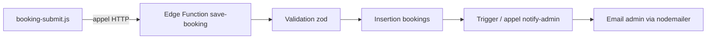

# PLAN D'ACTION — ANGEMUU : RÉSOLUTION DES PROBLÈMES AVEC DES DÉPÔTS OPEN SOURCE

**Date :** 2026-11-04
**Base :** audit [`plans/audit-technique-angemuu.md`](audit-technique-angemuu.md)
**Principe :** conserver le design, le formulaire, l'Admin, l'auth et la connexion Supabase actuels. N'intégrer que « ce qui résout un problème identifié ».

---

## 1. Correspondance Problème → Dépôt open source → Intégration

| Problème (audit) | Dépôt open source | Rôle dans Angemuu | Effort |
|---|---|---|---|
| P5 — Schéma non versionné | `supabase/supabase` (CLI + dossier `supabase/migrations/`) | Versionner toutes les tables + RLS + fonctions RPC | Moyen |
| P5 — Génération de la migration initiale | `outdent/supa_migrate` | Générer la migration initiale à partir de la base existante | Faible |
| P1 — Double réservation (race condition) | Pattern SQL « Partial Unique Index » (doc Postgres / Supabase) | Contrainte `UNIQUE (date, time)` où `status IN ('pending','confirmed')` → insertion atomique | Faible |
| P2/P6 — Validation serveur des réservations | `colinhacks/zod` + `supabase/edge-runtimes` | Edge Function `save-booking` qui valide (zod) puis insère ; le frontend appelle la fonction au lieu d'insérer en direct | Moyen |
| P4 — Notification automatique admin | `nodemailer/nodemailer` (email) | Edge Function `notify-admin` (ou inclus dans `save-booking`) → email à l'admin à chaque réservation | Moyen |
| P4 — Variante WhatsApp | `WhiskeySockets/Baileys` | Envoi WhatsApp automatique — lib non officielle, risque de bannissement du numéro (voir Risques) | Élevé |
| P4 — Variante push (alternative légère) | `binwiederhier/ntfy` | Notification push instantanée gratuite sans compte | Faible |
| P3/P11 — Admin exposé côté public | Refactorisation JS (pas de dépôt) — `supabase-client.js` partagé | Retirer `booking-admin.js` du site public ; `ADMIN_EMAILS` uniquement côté Admin | Faible |
| P7 — Pagination des réservations | API native Supabase (`.range()`) | Pagination/filtres dans la liste Admin | Faible |
| P10 — Horaires d'ouverture | Contrainte `CHECK` SQL (pas de dépôt) | Valider que `time` respecte les plages horaires | Faible |

---

## 2. Détail des intégrations

### 2.1 Versionner le schéma (P5)

- Installer la CLI officielle : `supabase/supabase` → `npx supabase init`.
- Utiliser `outdent/supa_migrate` pour **générer le dump initial** des tables, policies et fonctions existantes : `npx supa_migrate generate --out-dir supabase/migrations/`.
- Remplacer ensuite les scripts manuels `supabase/off_days.sql` et `supabase/rls-bookings-posts-comments.sql` par des migrations versionnées (ils restent comme documentation historique).

**Résultat :** le schéma `bookings`, `off_days`, `admin_users`, `posts`, `comments`, les policies RLS et les fonctions RPC sont reproductibles depuis le repo. La table `bookings` (créée manuellement au dashboard) cesse d'être une « boîte noire ».

### 2.2 Contrainte UNIQUE partielle — anti double réservation (P1)

Migration SQL à ajouter dans `supabase/migrations/` :

```sql
create unique index bookings_slot_unique
  on public.bookings (date, time)
  where status in ('pending', 'confirmed');
```

- Postgres garantit que **deux réservations actives ne peuvent pas occuper le même créneau**, même en cas de soumissions simultanées — la course critique « check-then-act » est éliminée.
- Côté `booking-submit.js` : on peut **supprimer l'appel RPC `is_slot_taken`** (devenu redondant) et gérer l'erreur de violation de contrainte (code 23505) pour afficher « créneau déjà pris ».
- `is_slot_taken` reste utile pour l'UX (désactiver les créneaux avant soumission) mais n'est plus la barrière de sécurité.

### 2.3 Séparer le bundle public du code Admin (P3/P11)

Refactorisation (aucun dépôt nécessaire) :

1. Créer `assets/js/supabase-client.js` : uniquement l'initialisation du client (`createClient`).
2. `index.html` charge `supabase-client.js` + `booking-submit.js` (sans `booking-admin.js`).
3. `admin/index.html` charge `supabase-client.js` + `booking-admin.js` + `blog-admin.js`.
4. Déplacer `ADMIN_EMAILS` dans un fichier hors du site public (ou le lire depuis `admin_users` via RLS admin).

**Résultat :** les emails admins et la logique admin ne sont plus visibles dans le code source du site public.

### 2.4 Validation serveur via Edge Function (P2/P6)

Architecture cible (option recommandée) :



- La Edge Function tourne **sur Supabase** (`supabase/edge-runtimes`, Deno) — indépendante d'Azure Static Web Apps.
- L'URL des fonctions est `https://kskjalzggxaycfzfgspc.supabase.co/functions/v1/save-booking` → **compatible avec le CSP actuel** (`connect-src ... supabase.co`).
- `colinhacks/zod` valide : nom requis, téléphone formaté, date future, heure dans les horaires, service non vide, longueurs max.
- En cas d'échec de validation → la fonction renvoie une erreur 400, aucune insertion.

**Option plus simple (sans Edge Function)** si l'utilisateur préfère : contraintes `CHECK` SQL + trigger Postgres de validation. Moins flexible mais zéro nouvelle dépendance.

### 2.5 Notification automatique à l'admin (P4)

Options classées par fiabilité :

| Option | Dépôt | Fiabilité | Note |
|---|---|---|---|
| **A — Email** (recommandée) | `nodemailer/nodemailer` | Haute | Nécessite un compte SMTP (Gmail, Zoho, Brevo…). Dans la Edge Function `save-booking` (ou après). |
| **B — Push ntfy** | `binwiederhier/ntfy` | Haute | Très simple : un `POST` HTTP vers un topic ; app notification iOS/Android/desktop. Gratuit, sans compte. |
| **C — WhatsApp auto** | `WhiskeySockets/Baileys` | Moyenne / Risquée | Lib non officielle : le numéro WhatsApp du salon peut être **banni**. À éviter en production sans test poussé. |

**Recommandation :** Option B (ntfy) ou A (nodemailer) comme notification fiable, et conservation du système actuel (`wa.me` côté client) en complément.

### 2.6 Pagination + horaires (P7/P10)

- `booking-admin.js` : ajouter `.range(offset, offset+limit)` et un sélecteur de filtre par statut (`pending`, `confirmed`, `canceled`) — API native Supabase, aucun dépôt.
- Migration : contrainte `CHECK (time between '08:00' and '19:00')` (ajustable) sur `bookings`.

---

## 3. Étapes d'implémentation (ordre logique)

1. **Initialiser les migrations** — CLI Supabase + `supa_migrate` (dump initial). Livrable : dossier `supabase/migrations/` reproductible.
2. **Contrainte UNIQUE partielle** (P1) — migration + adaptation de `booking-submit.js` (gestion erreur 23505, retrait du check-then-act).
3. **Séparation des bundles** (P3/P11) — création `supabase-client.js`, retrait de `booking-admin.js` du public, déplacement de `ADMIN_EMAILS`.
4. **Edge Function `save-booking`** (P2/P6) — validation zod + insertion atomique ; bascule de `booking-submit.js` sur la fonction.
5. **Notification admin** (P4) — ntfy ou nodemailer dans la Edge Function (ou fonction dédiée + trigger).
6. **Pagination + horaires** (P7/P10) — `.range()`/filtres dans la liste Admin + contrainte `CHECK`.
7. **Vérifications finales** — CSP (`staticwebapp.config.json`), RLS inchangées dans l'esprit (seules les contraintes sont ajoutées), test manuel du parcours complet (public → Supabase → Admin → notification).

---

## 4. Fichiers créés / modifiés

**Créés :**
- `supabase/migrations/001_init_dump.sql` (via `supa_migrate`)
- `supabase/migrations/002_bookings_unique_slot.sql` (contrainte partielle + CHECK horaires)
- `assets/js/supabase-client.js`
- `supabase/functions/save-booking/index.ts` (validation + insertion)
- `supabase/functions/notify-admin/index.ts` (ou notification intégrée à `save-booking`)
- (Optionnel) fichier de config CLI Supabase

**Modifiés :**
- `assets/js/booking-submit.js` — appel Edge Function + gestion doublon
- `assets/js/booking-admin.js` — retrait init client (déplacée), pagination/filtres
- `index.html` — charge `supabase-client.js`
- `admin/index.html` — charge `supabase-client.js` + `booking-admin.js`
- `staticwebapp.config.json` — vérification CSP (probablement inchangé)
- `config.toml` — nettoyage (clé OpenRouter inutilisée)

---

## 5. Risques et mitigations

| Risque | Mitigation |
|---|---|
| **Bannissement du numéro WhatsApp** si Baileys utilisé | Privilégier ntfy (push) ou nodemailer (email) ; Baileys uniquement en option très encadrée ou abandonnée |
| **Erreur 23505 mal gérée** → mauvaise UX utilisateur | Tester le parcours « créneau occupé » avant mise en production |
| **Edge Functions = coût Supabase** (invocations payantes au-delà du plan gratuit) | Volumétrie faible attendue (salon de coiffure) : plan gratuit suffisant ; sinon Option « contraintes CHECK » sans fonction |
| **HTML statique + fonctions** : latence réseau | Les fonctions sont au même domaine Supabase ; appel unique par soumission |
| **Régression du formulaire** (perte des fonctionnalités actuelles) | Aucun champ supprimé ; le formulaire conserve exactement ses inputs et son design |

---

## 6. Ce qui est conservé (inchangé)

- Design et pages du site Angemuu.
- Formulaire de réservation (champs et présentation).
- Page Admin (calendrier, jours off, blog) — seuls pagination/filtres ajoutés.
- Authentification Supabase (email/mot de passe) et liste blanche des admins (maintenue côté serveur via `admin_users` + `is_admin()`).
- Politiques RLS existantes — **seules des contraintes s'ajoutent, aucune policy n'est modifiée ou supprimée**.
- Notifications WhatsApp actuelles (`wa.me` côté client) gardées en complément.

---

## 7. Décisions à valider par l'utilisateur

1. **Notification admin** : Option A (email/nodemailer), Option B (push/ntfy), Option C (WhatsApp/Baileys risqué), ou conserver l'existant ?
2. **Validation serveur** : Edge Function + zod (recommandé) ou contraintes CHECK/triggers SQL (zéro dépendance) ?
3. **Horaires d'ouverture** : quelles plages autorisées (ex. 08h00–19h00) ?
4. **Filtres Admin** : filtres par statut suffisent-ils (pending/confirmed/canceled) ?
5. **Ordre d'exécution** : validez-vous l'ordre des étapes de la section 3 ?